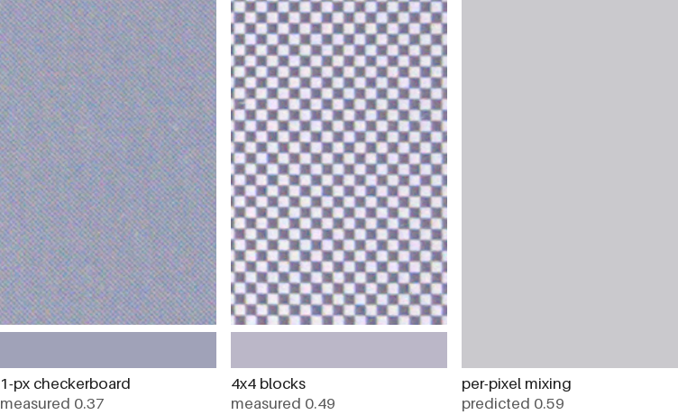

# spectra6-dotgain

Dithering for E Ink Spectra 6 colour e-paper (inks: black, white, yellow, red, blue, green) that accounts for dot
gain: on the panel, a light pixel next to darker pixels looks darker than its ink.

We measured this on our paperlesspaper OpenPaper L (13.3", 1600x1200) and dither for it. Side by side with
epdoptimize, the library the paperlesspaper app uses: https://marinsokol5.github.io/spectra6-dotgain/compare/

## What we measured



Left and middle: two patterns, each half black pixels, photographed on the panel. The bar under each is its measured
brightness (panel white = 1, black = 0.17). Right: what per-pixel mixing, treating every pixel as a flat patch of
its ink, predicts for both. The 1-px checkerboard comes out much darker than the 4x4 blocks.

From 6 RAW photos of a test chart on the frame:

- Darker neighbours bleed into a lighter pixel: with 1, 2, 3 or 4 darker neighbours (above, below, left, right),
  20, 27, 33 or 51 % of the pixel takes their colour.
- Yellow bleeds into a white neighbour almost as much as black does.
- Green in fine patterns looks yellow-green, while a solid green patch looks teal.

Together these rules make a panel model that predicts how any dithered image looks on the panel. Fitted on the
chart's patches, the first two rules predict the chart's gradients, which were left out of the fit, to 2.5
CIEDE2000 on average; per-pixel mixing gives 4.5. The green rule was set from a photo of the frame where our
output looked too yellow, and checked on a second photo.

## What we do

1. Map the photo to what the panel can show: a tone curve that keeps shadow detail, colours moved into what the
   inks can mix, and strongly saturated colours pulled to the panel's most saturated colour of that hue.
2. Error diffusion (Floyd-Steinberg, on light intensity rather than sRGB values). For each pixel it tries every
   ink, uses the panel model to predict how that pixel and its already placed neighbours will look, keeps the ink
   closest to the target, and passes on the remaining error. Each shared edge is counted once, when its second
   pixel is placed.

Python with numpy and numba, in `spectra6_dotgain/`; about 6 s per image on an M2.

## Results

On the real frame: 8 blind tests on our own photos, not the page's samples. Each test put two versions (once three)
on the frame together, and which was where stayed hidden until the frame's owner had picked.

- An earlier version with its own tone and colour mapping but no panel model lost to the app 2 of 3.
- Versions with the panel model beat the app 4 of 4, and that earlier version 2 of 2.
- This exact version was tested only against the previous model version, and won.

Simulated, as the mean over the page's images (S-CIELAB: colour difference from the photo after blurring both as
the eye does at 50 cm; lower is better):

| images | simulated with | paperlesspaper app, re-created | ours |
|---|---|---|---|
| 6 paperlesspaper samples | our panel model | 19.3 | 12.4 |
| | per-pixel mixing | 25.8 | 20.6 |
| 64 epdoptimize demo images | our panel model | 18.8 | 13.0 |
| | per-pixel mixing | 25.2 | 20.8 |

The panel-model rows favour us, since our dithering is designed for that model. Part of the gap is tone mapping, which
epdoptimize has but the app doesn't use.

## Tried, not kept

- A refinement pass that swaps dots after dithering (direct binary search): 0.03 better on 8 held-out images, but
  better on only 4 of them, with dots grouped into short worms, and 45 to 72 s per image instead of 4 to 6.
- Blue-noise jitter (0.001 better), the Ostromoukhov kernel (no gain on photos, many more stray black dots in light
  areas), tone-curve variants and designing for other glare levels (at most 0.04 better, on an earlier version).
- The dithering already scores within 0.07 of a perfect rendering of its own target, so further gains would have to
  come from the target (tone and colour), not from where the dots go.

## Run it

```
python3 -m venv .venv && .venv/bin/pip install -r requirements.txt    # tested with Python 3.12
.venv/bin/python -m spectra6_dotgain photo.jpg device.png --sim preview.png
```

`device.png` holds only the 6 device colours, rotated 90° clockwise into the panel's 1600x1200 if the photo is
portrait. It, and the page's A/B images, can be sent to a frame through paperlesspaper's API as `pictureDevice`.
`preview.png` is the panel model's simulation.

To rebuild the page (needs Node): `(cd scripts && npm ci) && .venv/bin/python scripts/build_compare.py`. On an M2
Mac it reproduces `compare/` byte for byte. The page stores only the device images and simulates them in the browser
with `compare/panel.js`, a port of the panel model that gives the same 8-bit pixels as `panel.py`. Browsers allow that
only over http, so to view it locally run `python3 -m http.server` here and open `localhost:8000/compare/`.

## How the page re-creates the app

`scripts/epdoptimize_app.mjs` follows the paperlesspaper web app's image editor, with epdoptimize 1.3.0. We built
it from the app's source and have not compared it with an image saved from the app.

1. Before dithering, scale the photo down to 1280 px on the long edge and back up to 1600. The editor does this
   with Fabric; we use Pillow's bilinear filter, so this step is approximate.
2. `suggestCanvasProcessingOptions(canvas, aitjcizeSpectra6Palette, {intent: "natural"})`, keeping only its
   dithering settings and dropping its tone mapping, as the app does.
3. `ditherImage` with the suggested settings: error diffusion on 8-bit sRGB (Floyd-Steinberg, or Stucki on 12 of the
   70 images), nearest ink by RGB distance. On 5 text and line-art images it matches colours in Lab instead, and on 3
   of those it does not dither at all. We run its JS engine; the app's WASM engine gives identical output on all 65
   images where it applies.
4. `replaceColors` to the device colours.

## Limits

- One panel, one room, 6 photos of the chart. They include window glare; we subtract a guessed amount as if it
  were grey, which leaves the model's black purple-blue.
- The green rule rests on one photo of the frame, checked on one more.
- The frame tests used our own photos, judged by the frame's owner. On the page, real skin appears only in some of
  epdoptimize's demo photos; the sample portrait is AI-generated.
- On flat graphics in pure sRGB colours (colour charts, UI screens), ours looks duller than the app. It keeps the
  hue by mixing inks, so pure yellow becomes half yellow and half green dots and pure blue gets red dots, where the
  app uses solid ink. These are the 8 of the 64 demo images on which ours scores worse with the panel model (7
  with per-pixel mixing).
- The model only sees the 4 direct neighbours. Viewing angle, temperature and ghosting are not measured.
- The measuring code and the chart photos are not included.

## License

Code: Apache-2.0. Sample images: paperlesspaper's, under their own terms (`samples/NOTICE`). Demo images:
epdoptimize's, under their own terms (`gallery/NOTICE`).
